# Rosetta

Rosetta works out what an undocumented JavaScript module does by running it, ports it to TypeScript, checks that the port behaves the same, and saves the verified behavior as a test suite.

🥈 **2nd Place, Best Use of Subquadratic**, AIE Code Summit Hackathon, Nov 7 2026 (Software Archaeology track, solo build).

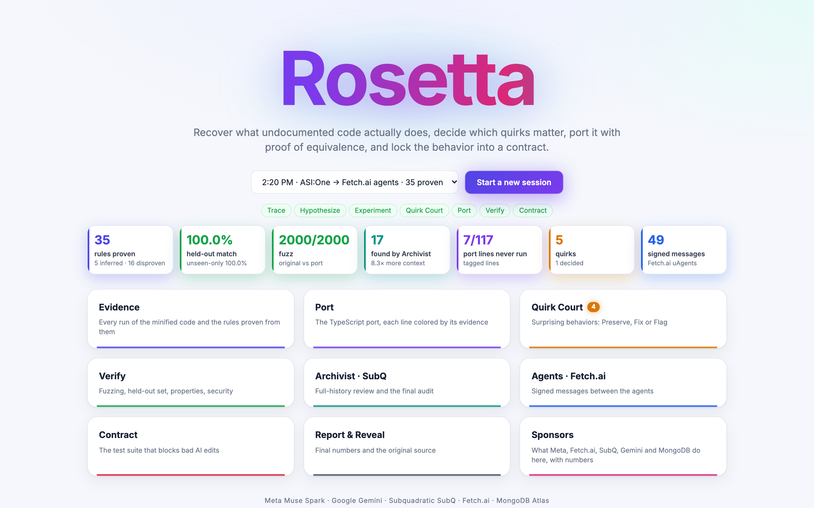

## Problem

Legacy code often has no docs or tests. The code is the only record of how it behaves, including edge cases other systems depend on. A rewrite, by a person or an LLM, can change that behavior without anyone noticing, and nothing stops the next edit from changing it again.

## How it works

The demo target is `ms@2.1.3` (Vercel, MIT), minified with terser `--toplevel` so every name is mangled (`target/ms.min.js`). The agents are only told it exports `f(val, options?)`. The original source is in `ground_truth/`, behind a path allowlist the agents can't read.

| Step | What happens | Model | Code |
|---|---|---|---|
| 1. Trace | Runs the module in a sandbox (`worker_threads` + `vm`, no host objects, JSON I/O, 200 ms timeout, each call 3× to catch nondeterminism) and stores every input and output | Gemini (seed inputs) | `src/sandbox/`, `src/tracer.ts` |
| 2. Hypothesize | Proposes rules that cite real run IDs. Each rule has a check in code (`applies` / `holds`) that is evaluated against the runs | Meta Muse Spark | `src/theorist.ts`, `src/predicate.ts` |
| 3. Experiment | 3–8 new inputs per rule, at least one chosen to disprove it. All predictions hold: proven. Any contradiction: disproven, with the counterexample | Meta Muse Spark | `src/loop.ts`, `src/declared.ts` |
| 4. Archivist | One request per round with the full history (~70k tokens vs the Theorist's ~8.5k) and a map of which code each run reached. Reports untested branches, untested input categories and weakly supported rules, which feed the next round | SubQ | `src/archivist.ts`, `src/coverage.ts` |
| 5. Quirk Court | Surprising behaviors are flagged. A person marks each Preserve, Fix or Flag, in the web UI or in ASI:One | Gemini | `src/quirks.ts` |
| 6. Port | Writes TypeScript from the proven rules and decisions. Must pass strict `tsc`. Each line is tagged with the rules it implements (`// @rule H12`) | Meta Muse Spark | `src/builder.ts`, `src/portcheck.ts` |
| 7. Verify | Runs original and port on every recorded input, 2,000 fuzz inputs and 500 held-out inputs never shown to the agents. Plus property tests and a ReDoS sweep | Gemini (properties) | `src/verify.ts`, `src/skeptic.ts`, `src/security.ts` |
| 8. Contract | Audits every tagged port line against the evidence, then writes a vitest + fast-check suite that later edits must pass | SubQ (audit) | `src/audit.ts`, `src/contract.ts` |

The loop is run by six Fetch.ai uAgents (coordinator, tracer, theorist, archivist, builder, skeptic). Every step is signed (secp256k1) and the backend rejects wrong, tampered or unknown signatures. A public `rosetta` agent on Agentverse lets you start a session and make Quirk Court decisions from ASI:One. Everything is stored in MongoDB Atlas, which also drives replay in the UI.

## Results

Session A (`s_20261107222044_b7b2`), started from ASI:One and run by the signed agents:

| | |
|---|---|
| Runs of the minified original | 449 |
| Rules proven / inferred / disproven | 35 / 5 / 16 |
| Rules found by the Archivist (SubQ) | 17 |
| Port v2 (Muse Spark) vs all recorded runs | 436/436, plus 7 that differ on purpose (Fix H3) |
| Fuzz | 2000/2000 |
| Held-out (500 inputs) | 500/500; 463/463 on inputs the agents never tried |
| Signed agent messages verified | 49/49 |
| Model calls | 29 (Meta 16, Gemini 7, SubQ 6) |

Session B (`s_20261107212548_b7e9`, CLI run) proved 39 rules and covers a Fix (H25) and a conflict between two decisions.

Behaviors found without being told what `f` does:
- Strings longer than 100 characters return `undefined`.
- `"42 "` parses, but `" 42"` doesn't.
- `""` throws, but `"   "` returns `undefined`.
- BigInt throws a `TypeError` instead of the usual `Error`.
- `NaN` errors print `val=null`.
- Long format turns plural at 1.5× the unit (`90000` gives `"2 minutes"`).

## Screenshots

**Evidence:** every run of the original, and the rule ledger with status, supporting runs and signer.
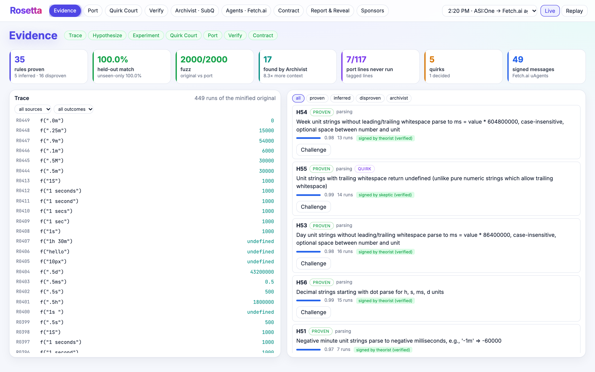

**Port:** each line colored by its evidence (green: proven and executed, yellow: inferred or never run, red: disproven rule).
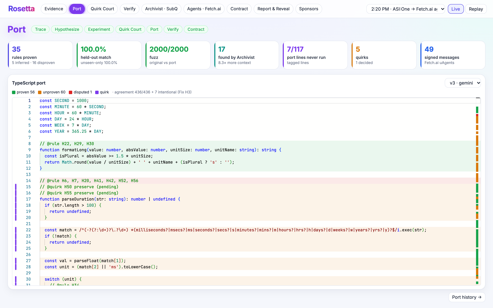

**Quirk Court:** Preserve, Fix or Flag for each surprising behavior. Applying decisions rebuilds and re-verifies the port.
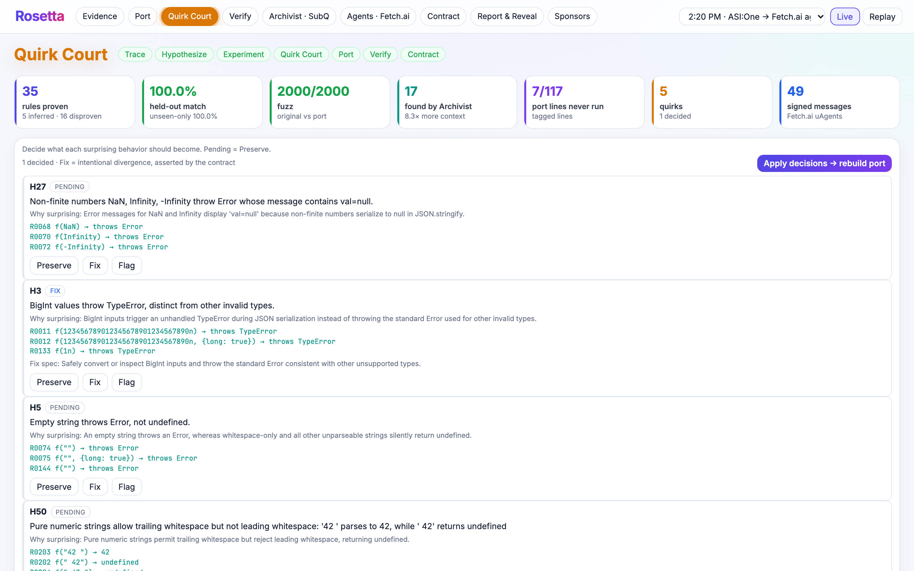

**Challenge:** reruns experiments on one rule. Here H52 (`.5m` → 30000, generalized to all `.Nm`) was disproven by `.1m` → 6000.
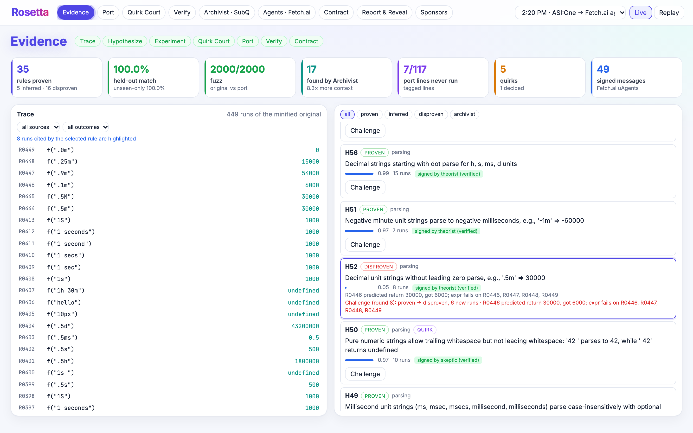

**Verify:** fuzz, held-out, property tests, security.
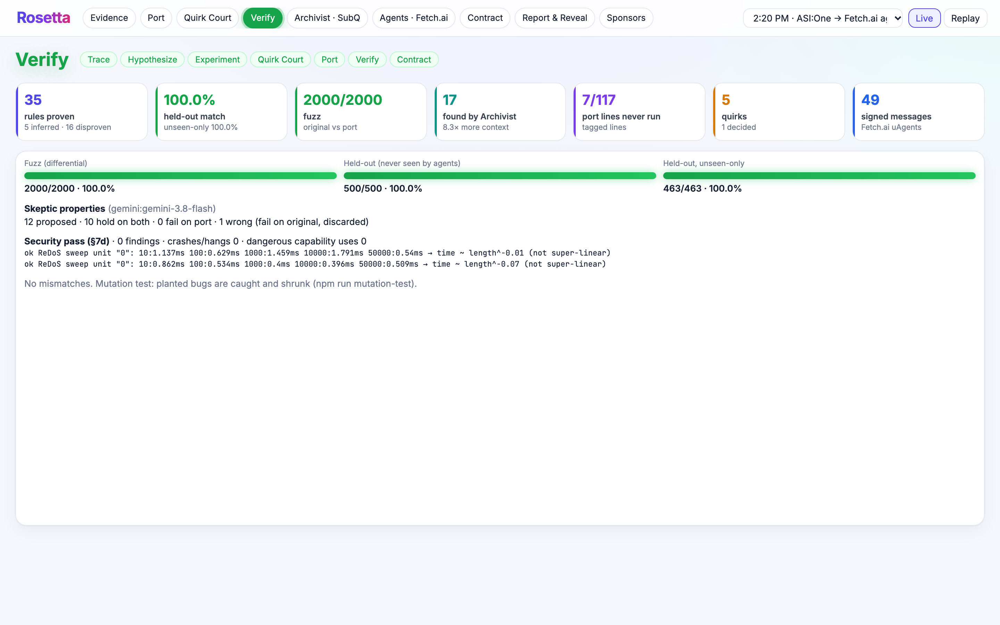

**Archivist (SubQ):** findings per round and the final audit of port tags.
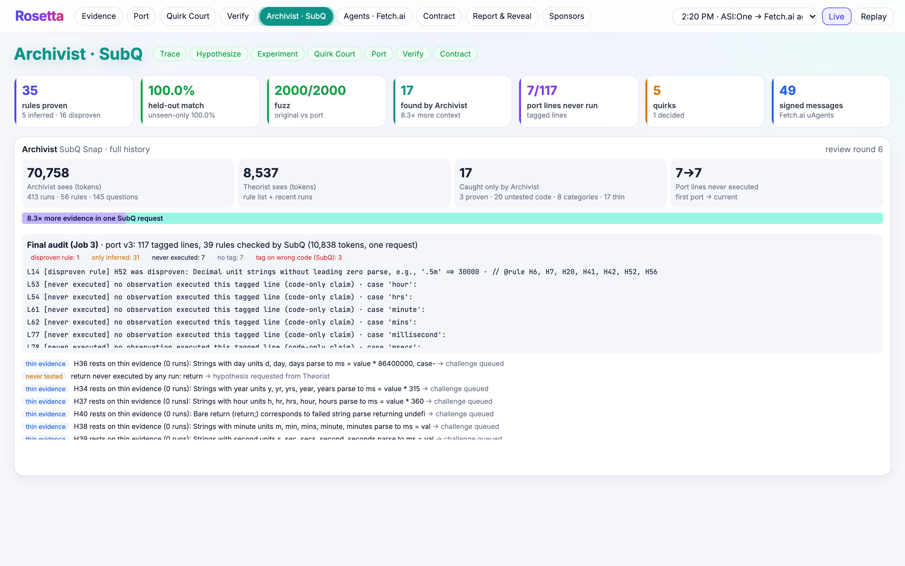

**Agents (Fetch.ai):** signed messages between agents.
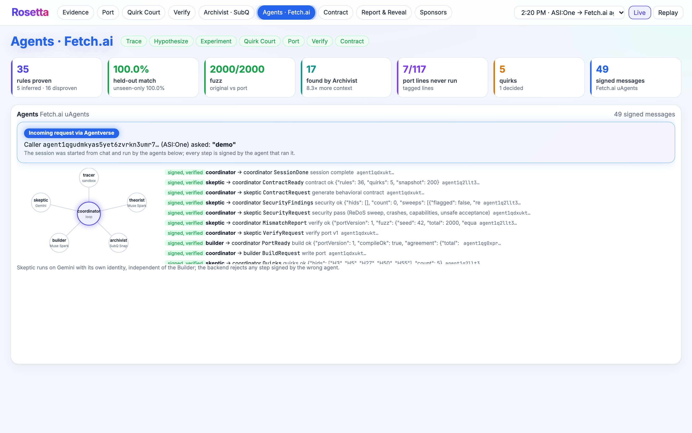

**Contract:** an edit changing the plural threshold from `1.5` to `2` is blocked, with the rules and inputs it breaks.
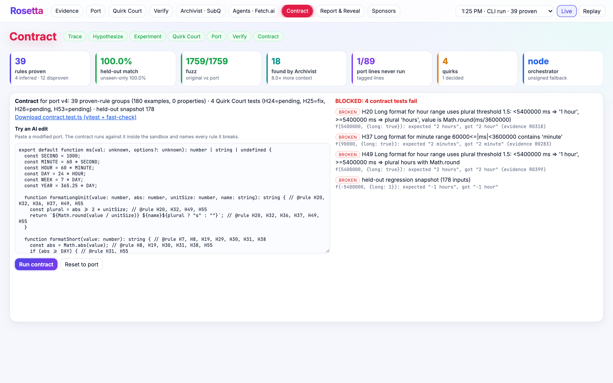

**Port history:** every port version, the model that wrote it, and its results.
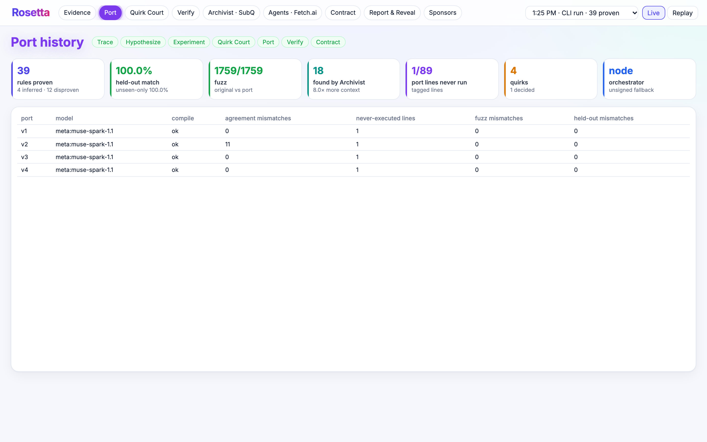

**Report and Reveal:** final numbers, and the original source shown next to the port after the session ends.
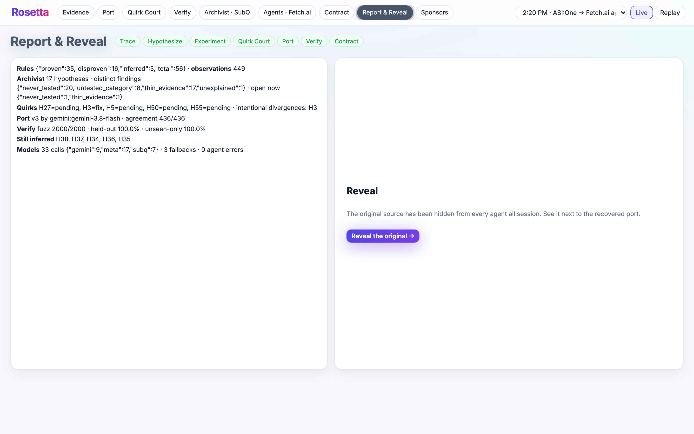
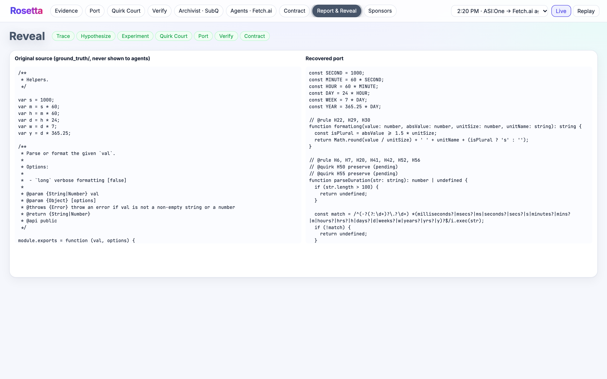

**Sponsors:** what each sponsor's product did in the session, computed from stored data.
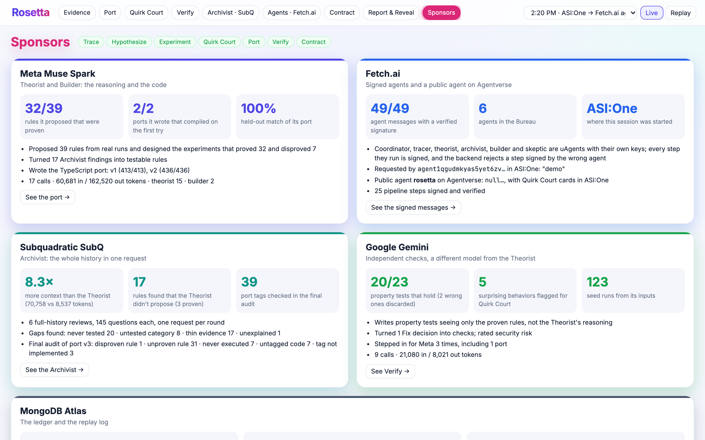

**ASI:One:** progress, Quirk Court and report cards.

| Progress | Quirk Court | Report |
|---|---|---|
| 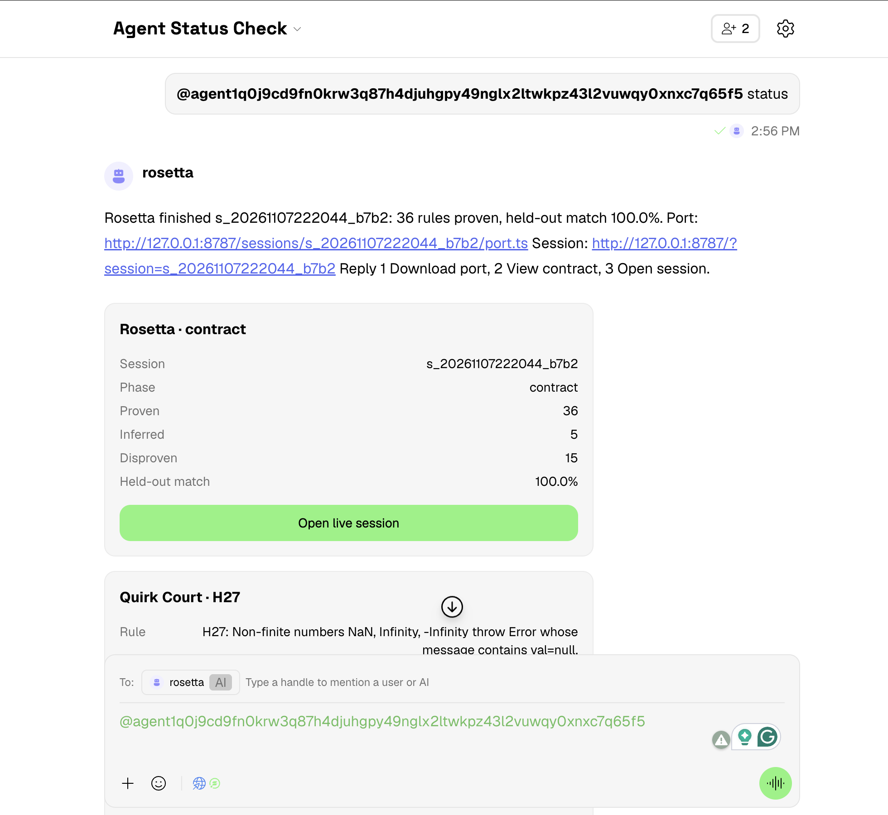 | 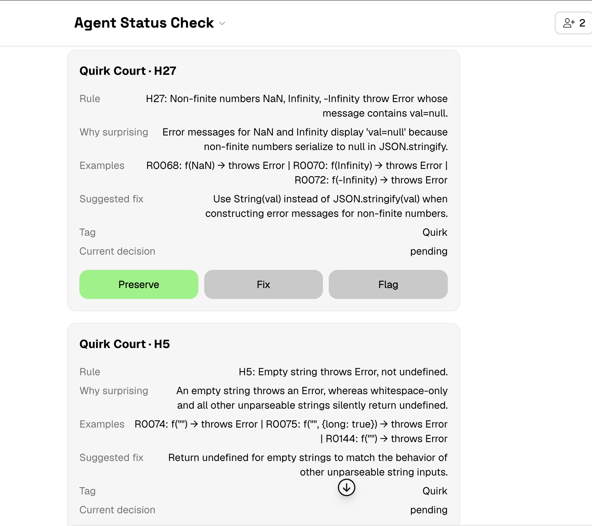 | 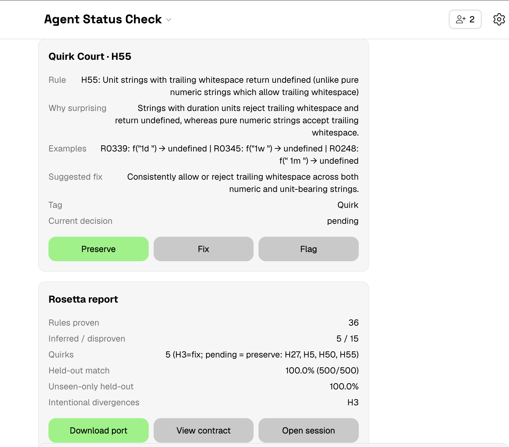 |

## Checks

| Script | Result |
|---|---|
| `npm run mutation-test -- --session <id> --version 1` | 3 planted bugs in a correct port, all 3 caught |
| `npm run guard` | Agent-side reads of `ground_truth/`, including `../` paths, all blocked |
| `npm run sandbox-test` | Hangs and crashes recorded, randomness flagged, 5 escape attempts blocked |
| `npm run provenance-test` | Forged, tampered and wrongly signed messages rejected |
| `npm run declared-test` | Experiments whose input doesn't match the stated call rejected |
| `npm run security-sanity` | ReDoS check flags `/^(a+)+$/`, not `/^a+$/` |
| `npm run contract-test` | Generated contract: 390/390 pass on the port |

## Run it

Requirements: Node 20+, Python 3.11, and a `.env` (see `.env.example`) with `MODEL_API_KEY` (Meta), `GEMINI_API_KEY`, `MONGODB_URI`, `SUBQ_API_KEY`, `AGENTVERSE_API_KEY`.

```bash
npm install && (cd ui && npm install && npx vite build)
python3 -m venv agents/.venv && agents/.venv/bin/pip install -r agents/requirements.txt
agents/.venv/bin/python agents/keys.py      # agent seeds and addresses into .env

npm run server                               # backend and UI on http://localhost:8787
agents/.venv/bin/python agents/bureau.py     # Fetch.ai agents (optional)
agents/.venv/bin/python agents/service.py    # ASI:One agent (optional)
npm run e2e                                  # full pipeline from the CLI
```

Open a session with `?session=<id>&view=<section>`, add `&mode=replay` to replay it. Without the Bureau running, the backend runs the same steps itself and marks them unsigned.

## Limitations

- Only `ms` was run end to end. Fuzz generators are tuned for string and number inputs, one module at a time.
- A few rules stay `inferred` in each run and aren't counted as proven.
- Our SubQ key only had the Snap Decisions model, so the code map is built mechanically and SubQ answers questions about it.
- ASI:One shows the agent's replies but not messages it sends on its own, so chat works on request (`status`, `quirks`).
- Runs locally; not deployed.

## Disclosure

All code was written during the hackathon on Nov 7 2026, with Claude Code as a coding assistant. Before the event I had only the written spec. `ms@2.1.3` is by Vercel under the MIT license (`ground_truth/LICENSE.ms.md`). `targets/redos_demo.js` is a deliberately vulnerable module written for the security check.
