# Rosetta

Rosetta helps teams migrate legacy code that nobody understands any more. It works out what an undocumented JavaScript module does by running it, lets a person decide which odd behaviors to keep, ports it to TypeScript, checks that the port behaves the same, and turns the result into a test suite that future changes must pass.

🥈 **2nd Place, Best Use of Subquadratic** 

AIE Code Summit Hackathon, Nov 7 2026. Track: Software Archaeology. Solo build. Repo: https://github.com/KamayaniR/rosetta

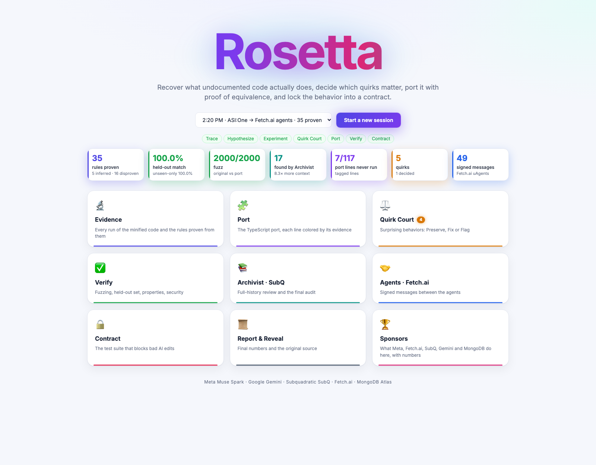
*Home screen for session A, which was started from ASI:One and run by the Fetch.ai agents.*

## Contents
1. [Problem](#problem)
2. [Impact](#impact)
3. [What it does](#what-it-does)
4. [What we ran and how it was checked](#what-we-ran)
5. [Results](#results)
6. [Walkthrough](#walkthrough)
7. [How it works](#how-it-works)
8. [Sponsor integrations](#sponsor-integrations)
9. [How the results are checked](#how-the-results-are-checked)
10. [Run it](#run-it)
11. [Repo map](#repo-map)
12. [Limitations](#limitations)
13. [Disclosure](#disclosure)

## Problem

- Teams depend on code nobody fully understands: legacy systems, minified bundles, and a growing amount of AI-written code.
- Rewrites and ports change behavior that other systems rely on, often without anyone noticing.
- AI-written ports mix what was observed with what was guessed, and you can't tell which is which.
- Nothing stops the next edit from breaking the behavior again.

## Impact

**Who it's for**
- **Teams migrating legacy JavaScript** (to TypeScript, to a new framework, out of a vendored or minified bundle) that need the new code to behave like the old code, including the parts nobody wrote down.
- **Teams reviewing AI-written code.** An AI can rewrite a module in minutes, but someone still has to check that it does the same thing. Rosetta gives that check a list of rules, the evidence for each, and a test suite.
- **Teams that inherit code with no tests**, where the code itself is the only specification.
- **Security and maintenance work**, where a migration is the moment to fix a dangerous behavior, but only if you know which odd behaviors other systems rely on.

**The problem it addresses.** A rewrite rarely fails on the main path. It fails on the edges: what happens with an empty string, a negative number, a trailing space, a wrong type, a number just past a rounding boundary. Those edges are what other code depends on. In `ms` alone, Rosetta found that:
- `"42 "` parses but `" 42"` doesn't;
- `""` throws, but `"   "` returns `undefined`;
- BigInt throws a different error type from every other bad input;
- long format turns plural at 1.5× the unit, not at 2×.

A hand-written or AI-written port could change any of these without anyone noticing. A single one of those changes, such as a "simplified" plural rule, is exactly what the contract blocked in the demo.

**What changes with Rosetta**
- **Behavior is written down from evidence, not memory.** Every rule points to the runs that support it, and rules that turn out wrong are kept as disproven, with the counterexample.
- **Guesses are labeled.** "Proven" and "inferred" are separate, and each port line is colored by which one it rests on. Lines no real run ever executed are listed.
- **A person decides what changes.** Odd behaviors are kept by default. Changing one is an explicit Fix decision, which is then tested. Overlapping decisions are reported as conflicts.
- **The port is checked, not trusted.** Same outputs on every recorded run, on 2,000 fuzz inputs, and on 500 held-out inputs the system never saw.
- **The behavior stays fixed after the migration.** The contract is a normal vitest suite that runs in CI. A later edit, by a person or an AI, that changes a proven behavior fails it, with the rule and the input named.
- **There is an audit trail.** Every rule, port version and verdict is stored with the agent that produced it and that agent's signature.

**Cost.** One full run on `ms` took about 12 minutes and 25–30 model calls (Meta, Gemini, SubQ). It produced 35–46 proven rules, a typed port, and a contract of about 400 tests. Doing the same by hand means reading minified code, writing probe inputs, and writing tests for each edge case, which usually takes hours to days for a module like this. And a manual approach doesn't produce the evidence links or the held-out check.

**What it doesn't do yet.** It has been run end to end on one library. The fuzz generators are tuned for functions that take strings and numbers. It works on a single module at a time, not on a whole application. See [Limitations](#limitations).

## What it does

**Input:** a minified JavaScript module. The demo uses `ms@2.1.3` (Vercel, MIT), minified with terser `--toplevel` so all names are mangled. The agents are only told that the module exports `f(val, options?)`. They never see the original source.

**Output:**

| Output | Where |
|---|---|
| A typed TypeScript port. Each line is tagged with the rules it implements (`// @rule H12`) and the quirks it keeps or changes (`// @quirk H25 fix`) | `out/ms.port.ts`, Port page |
| A rule ledger: each rule is `inferred`, `proven` or `disproven`, linked to the runs that support it, with its status history and the agent that signed it | Evidence page, `GET /sessions/:id/audit` |
| Quirk Court: surprising behaviors that a person marks Preserve, Fix or Flag, in the web UI or in ASI:One | Quirk Court page, ASI:One |
| An equivalence report: differential fuzzing, a held-out set the agents never see, property tests, a security pass | Verify page, `out/report.json` |
| A behavioral contract: a vitest + fast-check suite, plus a way to run it against an edited port | `out/contract.test.ts`, Contract page |

<a name="what-we-ran"></a>
## What we ran and how it was checked

**The code being migrated** is `ms`, a real npm library by Vercel that converts durations: `ms("2h")` gives `7200000`, and `ms(60000)` gives `"1m"`. We minified it with terser so every name is scrambled. That copy, `target/ms.min.js`, stands in for "code nobody on the team understands". The original source was kept in `ground_truth/`, which the agents can't read.

**The system is the code in this repo.** For each session it does the following, and all of it is code you can rerun:

1. **Runs the minified code.** It runs `target/ms.min.js` hundreds of times in a sandbox (`src/sandbox/`) and stores every input and output in MongoDB. Session A has 449 recorded runs.
2. **Writes rules.** Muse Spark writes rules about the behavior. Each rule comes with a check in code (`applies` / `holds`) that the system evaluates against the real runs (`src/predicate.ts`). A person doesn't decide whether a rule holds; the check does.
3. **Writes the port.** Muse Spark writes the TypeScript port (`out/ms.port.ts`). It has to compile under strict TypeScript (`src/portcheck.ts`).
4. **Runs both versions on the same inputs and compares the outputs** (`src/verify.ts`). The comparison is strict: same return value or same error type, `NaN`/`-0`/`undefined` treated exactly, and so on. It's done on:
   - every recorded run (436/436 in session A);
   - 2,000 new inputs from fast-check (2000/2000);
   - 500 held-out inputs from a fixed seed. These are generated once, stored separately, and never shown to any agent (500/500).
5. **Generates the contract.** The result is written out as `out/contract.test.ts`, a normal vitest file (390 tests in session A), which you can run with `npm run contract-test`.

**Sample held-out inputs, run on the original and on the port** (session A, port v2 by Muse Spark; all 500 match):

| Input | Original `ms` | Rosetta's TypeScript port | |
|---|---|---|---|
| `f(-12)` | `"-12ms"` | `"-12ms"` | same |
| `f(9000000, "long")` | `"3h"` | `"3h"` | same |
| `f(1500, {long: false})` | `"2s"` | `"2s"` | same |
| `f(-907200000, {long: "yes"})` | `"-10 days"` | `"-10 days"` | same |
| `f("-96.\tM", "long")` | `undefined` | `undefined` | same |
| `f({a: 1}, {long: "yes"})` | throws `Error: val is not a non-empty string…` | throws `Error: val is not a non-empty string…` | same |
| `f("15\tHr", true)` | `undefined` | `undefined` | same |
| `f(-3600000, {long: false})` | `"-1h"` | `"-1h"` | same |
| `f(931815, "long")` | `"16m"` | `"16m"` | same |
| `f(907199999)` | `"10d"` | `"10d"` | same |
| `f("-28.  msecs", {})` | `undefined` | `undefined` | same |

**How we checked the checks.** A comparison that always says "same" would be useless, so these scripts test the testing itself:

| Script | What it does | Result |
|---|---|---|
| `npm run mutation-test -- --session <id> --version 1` | Puts 3 small bugs into a correct port (plural threshold 1.5 → 2, length limit 100 → 50, `Math.round` → `Math.floor`) and runs the fuzzer | All 3 caught. Example: `f(90000, {long: 1})` gives `"2 minutes"` in the original and `"2 minute"` in the bugged port |
| Contract page, edited port | Runs the contract against a port with one changed number | Blocked: 4 tests fail, naming the rules |
| `npm run security-sanity` | Runs the ReDoS check on a module we wrote to be vulnerable (`/^(a+)+$/`) and on a safe one | Vulnerable one flagged (times out at 100 characters), safe one not |
| `npm run guard` | Tries to read the hidden original source from the agent side, including `../` paths | All blocked |
| `npm run sandbox-test` | Runs code that hangs, overflows the stack, uses randomness, or tries to escape the sandbox | Timeouts and crashes recorded, randomness flagged, 5 escape attempts blocked |
| `npm run provenance-test` | Sends forged, tampered and wrongly signed agent messages | All rejected |
| `npm run declared-test` | Gives an experiment whose input doesn't match its stated call | Rejected before running |
| `npm run contract-test` | Runs the generated vitest contract against the port | 390/390 pass |

Checks that run automatically on every session: agreement with all recorded runs, fuzzing, the held-out score, property tests, line evidence, the security pass, and the final audit. Results are stored per port version and shown on the Verify, Archivist and Port history pages.

## Results

Two sessions from today, taken from the stored reports.

| | Session A (demo): started from ASI:One, run by the signed Fetch.ai agents (`s_20261107222044_b7b2`) | Session B: CLI run with a Fix and a decision conflict (`s_20261107212548_b7e9`) |
|---|---|---|
| Runs of the minified original | 449 | 470 |
| Rules proven / inferred / disproven | 35 / 5 / 16 (one disproven by a Challenge) | 39 / 4 / 12 |
| Rules found by the Archivist (SubQ) | 17 | 18 |
| Archivist context vs Theorist context | 70,758 vs 8,537 tokens (8.3×) | 70,887 vs 8,857 tokens (8.0×) |
| Port written by | Meta Muse Spark (v2) | Meta Muse Spark |
| Port agreement with all observations | 436/436, plus 7 runs that differ on purpose (Fix H3, decided in ASI:One) | 448/448, plus 22 that differ on purpose (Fix H25) |
| Differential fuzz | 2000/2000 | 1759/1759, plus 241 inputs checked against the Fix |
| Held-out (500 inputs, fixed seed, never shown to the agents) | 100% | 100% |
| Held-out, excluding inputs the agents happened to try | 463/463 | 400/400 |
| Property tests (Gemini) | 11 proposed, 10 hold, 1 discarded | 14 proposed, 11 hold, 2 discarded |
| Security pass | 0 findings | 0 findings |
| Signed agent messages verified by the backend | 49/49 | n/a (CLI run) |
| Model calls | 29 (Meta 16, Gemini 7, SubQ 6), 0 agent errors | 36 (Meta 17, Gemini 13, SubQ 6), 0 agent errors |

Behaviors the agents found without being told what `f` does:
- It parses durations with every unit alias (`"1h"`, `"2 days"`, `"3 YRS"`, `"1.5ms"`).
- Strings longer than 100 characters return `undefined`.
- `".5"` parses, but `"5."`, `"+42"`, `"1e3"` and `"0x2a"` don't.
- `""` throws, but `"   "` returns `undefined`.
- `"42 "` parses, but `" 42"` doesn't.
- BigInt throws a `TypeError` instead of the usual `Error`.
- `NaN` errors print `val=null`.
- Long format switches to plural at 1.5× the unit (`90000` gives `"2 minutes"`).
- `-0` formats as `"0ms"`.

<a name="walkthrough"></a>
## Walkthrough

The web UI opens on a home screen with the headline numbers and one button per section. Each section is a separate page. Every session can be watched live or replayed from its stored events, and links can point at a section: `?session=<id>&view=<section>&mode=replay`.

### Evidence and port
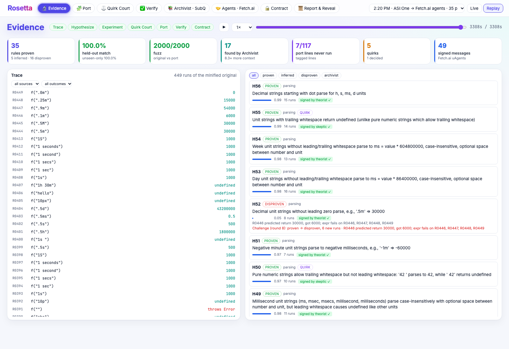
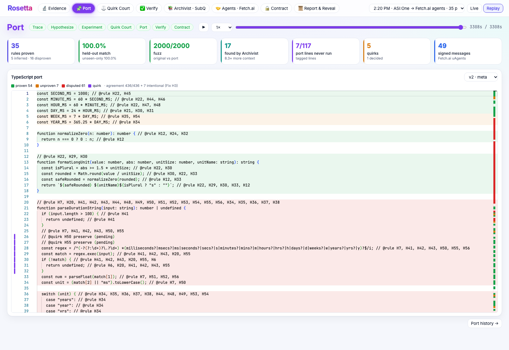
- **Evidence page:** the left side lists every run of the minified original. The right side is the rule ledger, with status, confidence, number of supporting runs, the signing agent, and a marker on rules the Archivist found. Clicking a rule highlights the runs it cites.
- **Port page:** each tagged line is colored by its evidence:
  - green: all of its rules are proven and a real run executed the line;
  - yellow: a rule is only inferred, or the line never ran;
  - red: a rule was disproven.

  Quirk lines are marked purple. Hovering a line shows its rules and how many runs executed it.

### Quirk Court
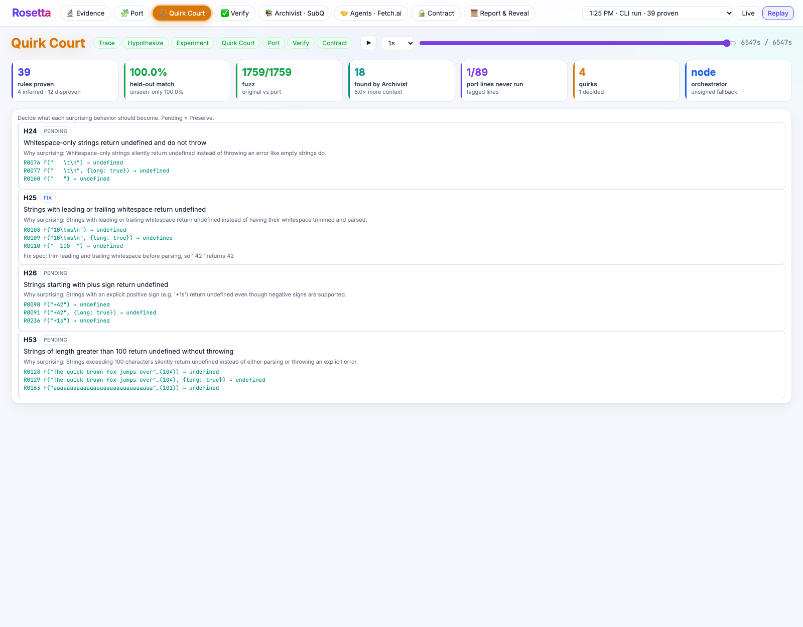
Each card shows the rule, why it's surprising, example runs, and a suggested fix, with Preserve, Fix and Flag buttons. Pending counts as Preserve. A Fix takes one line describing the intended behavior, which the Skeptic turns into a check. "Apply decisions" then rebuilds the port, re-verifies it, and regenerates the contract.

### Challenge
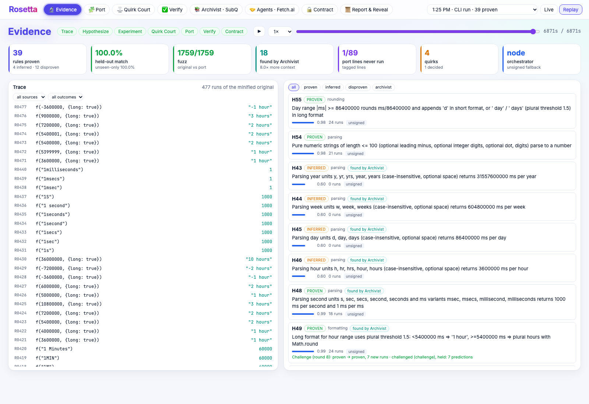
*Session A: H52 after a Challenge disproved it. The challenge runs are at the top of the trace.*

Each rule card has a Challenge button, which runs one extra experiment round on that rule only.
- **H52, disproven.** H52's check said every `.Nm` string returns 30000, generalized from its one example (`.5m`). The challenge ran `.1m` (6000), `.25m` (15000) and `.0m` (0), so H52 was disproven. The behavior was right; the rule was too narrow. When a challenge disproves a rule, the Theorist proposes a corrected rule, and it's tested right away.
- **H49, held.** Challenging H49 (the 1.5× plural threshold) ran inputs at the boundary: `5399999` gives `"1 hour"`, while `5400000` and `5400001` give `"2 hours"`. The rule held.

A Stop button ends a running session: steps already running finish, and no new ones start.

### Verify
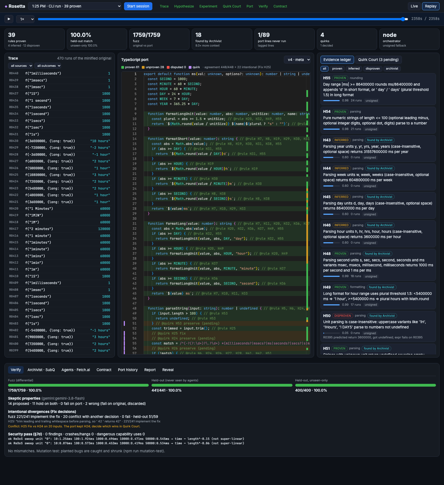
- **Fuzz:** 2,000 generated inputs run on both the original and the port.
- **Held-out:** 500 inputs the agents never see, plus the score on the subset they never happened to try.
- **Properties:** Gemini writes general properties. Any property that fails on the original is discarded, not counted against the port.
- **Fix-covered inputs:** checked against the fix instead of the original.
- **Conflicts:** when two decisions cover the same inputs, Rosetta reports it instead of picking one. Session B: "H25 Fix vs H24 Preserve on 20 inputs; the port kept H24."
- **Security pass:** a ReDoS timing sweep from 10 to 50,000 characters, flat for `ms`.

### Archivist (SubQ)
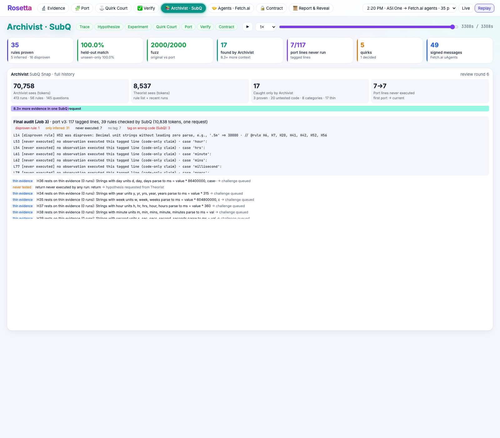
Once per round, one SubQ request gets the whole bundle and the full history (every run, every rule with its history, the quirks): about 70k tokens, while the Theorist's prompt is about 8.5k. It lists code that no run has executed, input categories that were never tested, and rules with little evidence, along with what was done about each.

**Final audit.** Before the contract is generated, every tagged line of the port is checked:
- the rule it cites must exist and be proven;
- a real run must have executed the line;
- quirk tags must match the Quirk Court decision.

Untagged executable lines are listed. Then one SubQ request (the port plus the ledger, about 10.8k tokens) asks, for each tagged rule, whether the tagged lines implement it. On session A's latest port, the audit found the port still citing H52 after the Challenge had disproven it, and 3 tags on code that doesn't implement the rule.

### Agents (Fetch.ai)
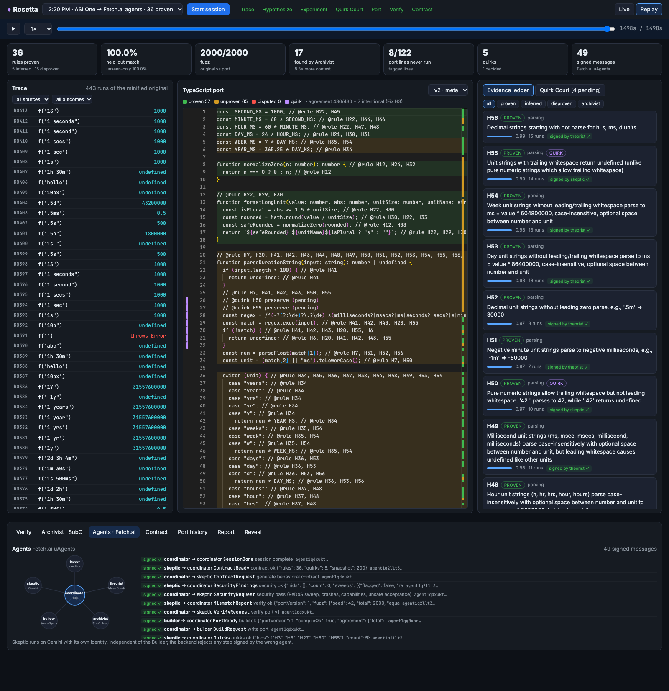
The coordinator runs the loop by messaging the Tracer, Theorist, Archivist, Builder and Skeptic. Every message and step request is signed by the sending agent, and the backend checks the signature before writing anything: 49 of 49 verified in session A.

### Contract
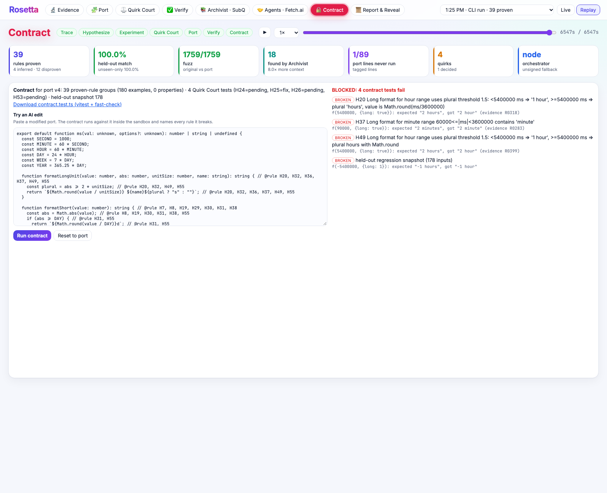
An edited port, with the plural threshold changed from `1.5` to `2`, is run against the contract in the sandbox. Four tests fail: H20, H37, H49 and the held-out snapshot. Each failure shows the input, for example `f(90000, {long: true})`: expected `"2 minutes"`, got `"2 minute"`. The same contract is written to `out/contract.test.ts` for vitest.

### Port history
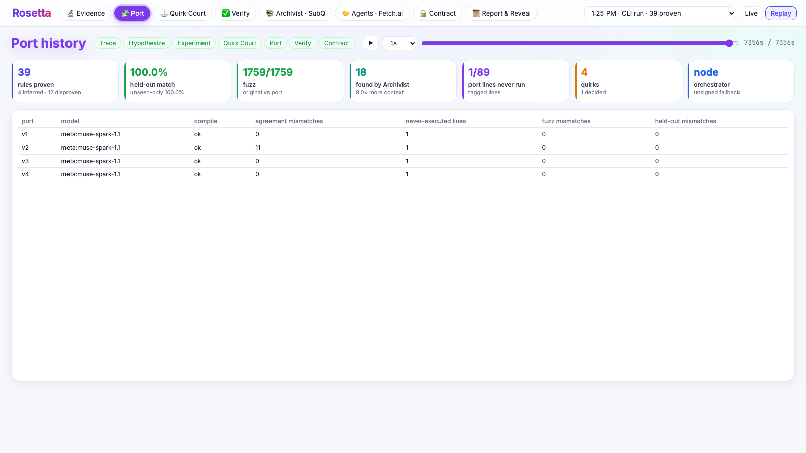
Every port version, with the model that wrote it, the compile result, mismatches, and lines that never ran. In session B, applying the trim Fix:
- **v2 failed (11 disagreements).** The Skeptic's first check for the fix was broader than the fix itself.
- **v3 and v4 pass.** The check was rewritten as a transform: new f(x) = original f(x.trim()).

### Report and Reveal
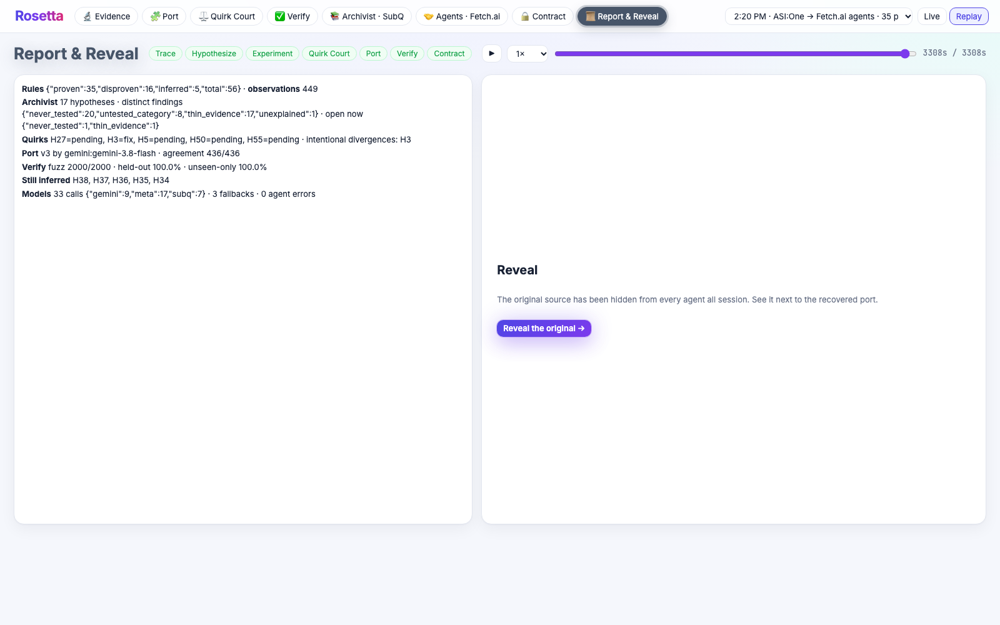
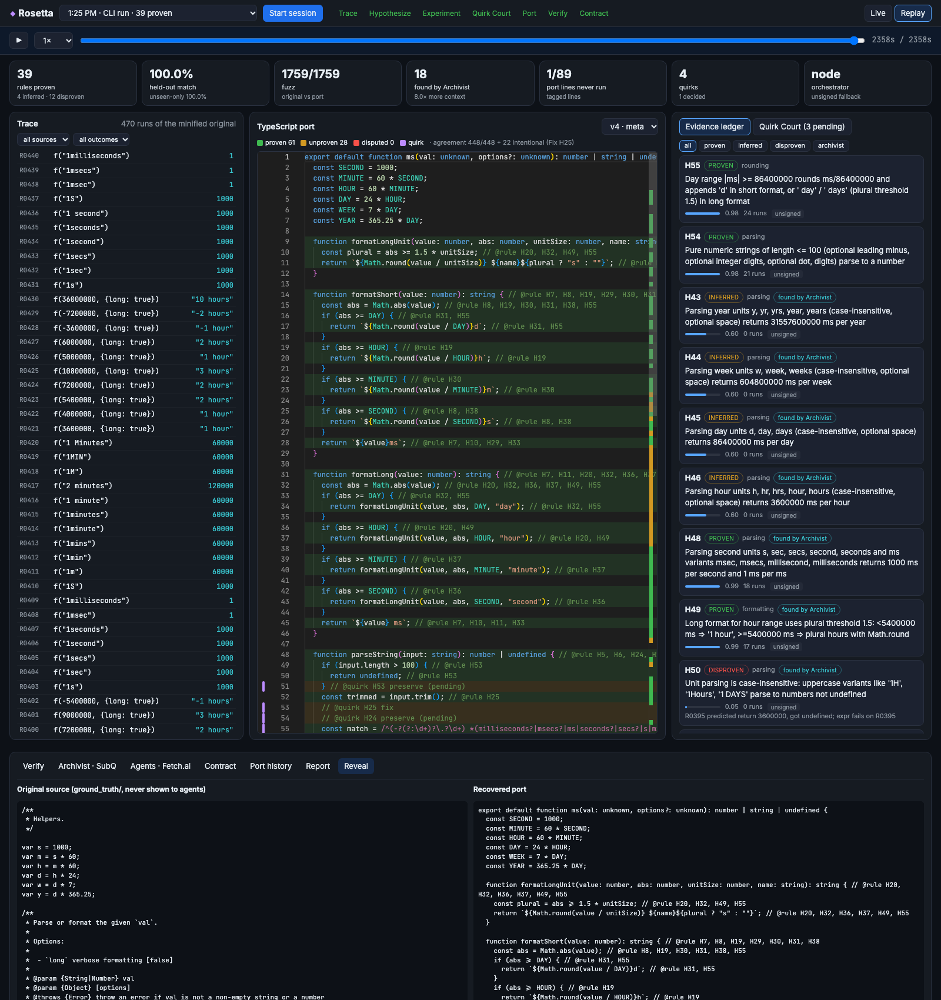
The original `ms` source sits behind a path allowlist the agents can't get past. Only the Reveal page reads it, and only after the session ends.

### Sponsors
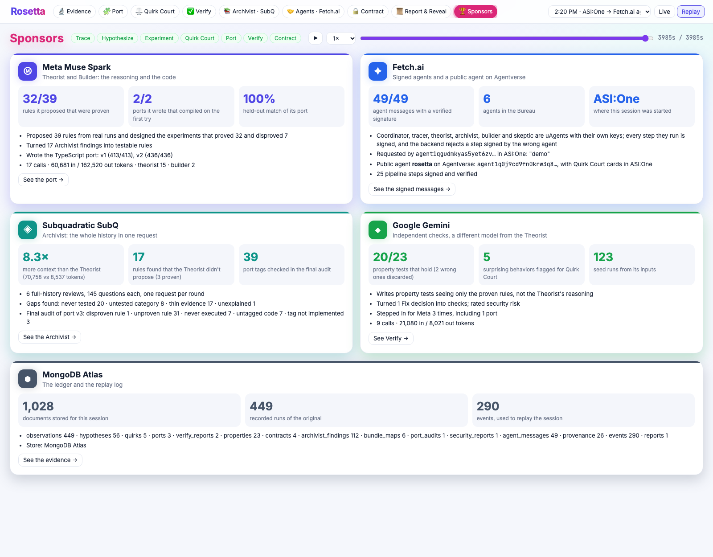
One page per session showing what each sponsor's product did, computed from the stored data (`GET /sessions/:id/sponsors`). In session A, for example: 32 of the 39 rules Muse Spark proposed were proven, and both ports it wrote compiled on the first try; 49 of 49 agent messages had a verified signature; SubQ saw 8.3× more context than the Theorist and found 17 rules; 20 of 23 Gemini property tests held; and 1,028 MongoDB documents were stored. For sessions started from ASI:One, the Agents page also shows the incoming request: the caller's address and what they asked.

### ASI:One
| Progress card | Quirk Court cards | Report card |
|---|---|---|
| 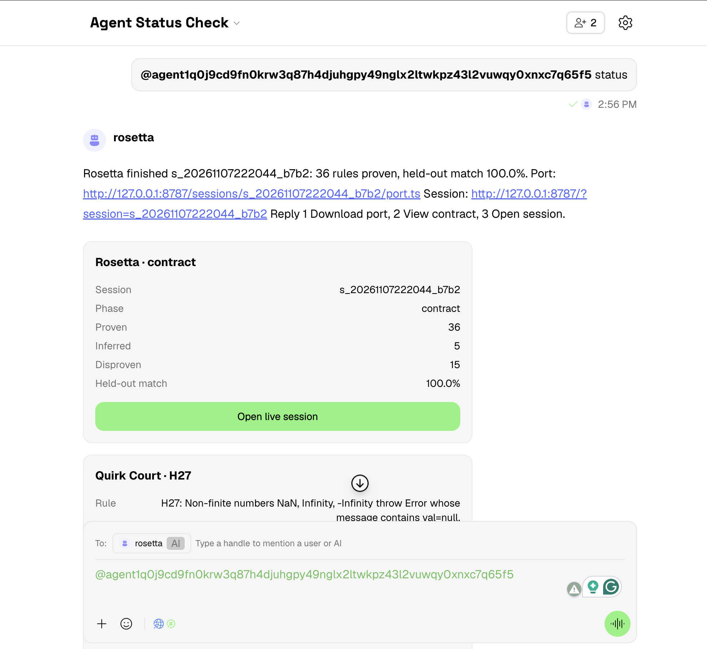 | 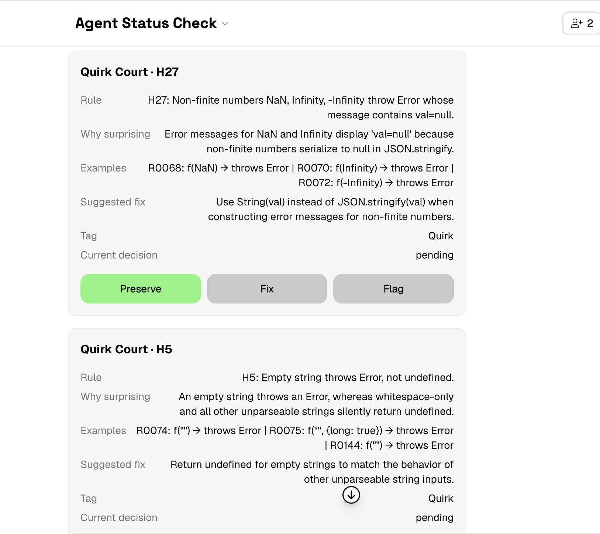 | 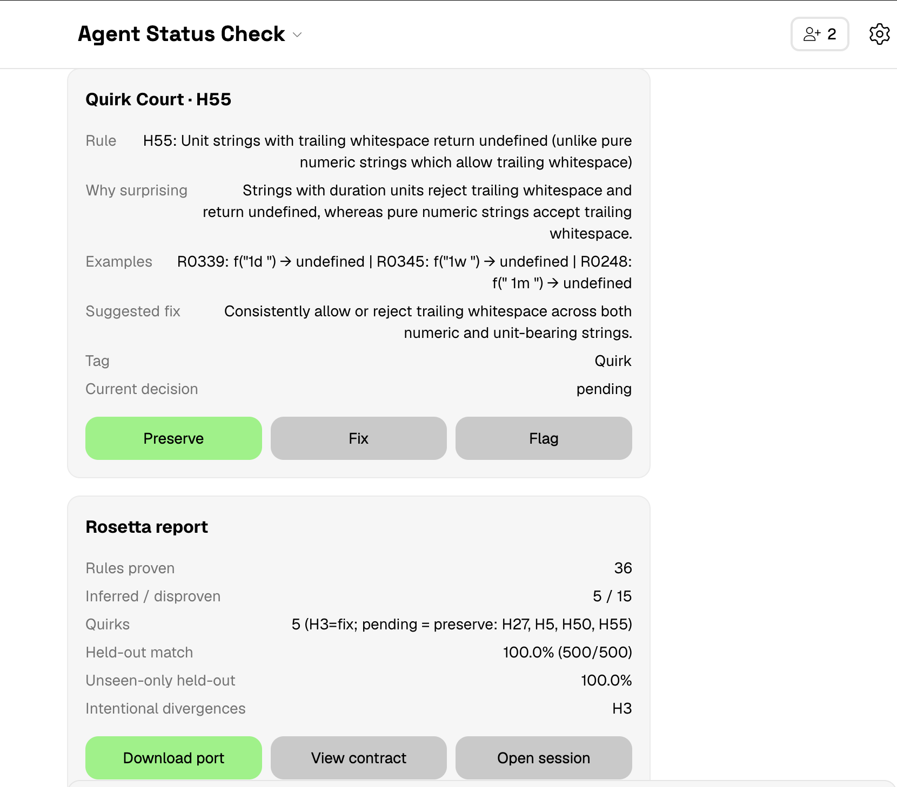 |

Session A was started from ASI:One with `@rosetta demo`.
- `status` returns a progress card.
- `quirks` returns one card per quirk, with Preserve, Fix and Flag. Fix opens a one-line form, or you can type `fix H3: <intended behavior>`.
- At the end, `status` also returns the report card, with links to download the port, view the contract and open the session.

Decisions made in chat go to the same database as the web UI.

<a name="how-it-works"></a>
## How it works

```
 ASI:One chat ──► rosetta agent (Agentverse, chat protocol + cards)
                          │
 Web UI (React, Monaco) ◄─SSE── Backend (Fastify, TypeScript) ◄── signed requests ── Fetch.ai Bureau
                          │                                       coordinator → tracer, theorist, archivist, builder, skeptic
             sandbox (worker_threads + vm)            MongoDB Atlas
             Meta Muse Spark · Gemini · SubQ Snap
```

| Step | What happens | Model | Code |
|---|---|---|---|
| 1. Trace | About 60 seed inputs covering JS types, string shapes and number edge cases, each run with and without `{long: true}`. Each call runs 3 times in a fresh `vm` context to catch nondeterminism. The context has no host objects (inputs and outputs cross as JSON strings), a 200 ms timeout, TZ=UTC, and a log of globals the code touches | Gemini (seeds) | `src/sandbox/`, `src/tracer.ts`, `src/seeds.ts` |
| 2. Hypothesize | Rules that cite run IDs, each with a check written as two JS expressions (`applies`, `holds`). Rules citing runs that don't exist are rejected and re-asked once. Rules contradicted by existing runs are disproven immediately. Duplicates are dropped | Meta Muse Spark | `src/theorist.ts`, `src/hypotheses.ts`, `src/predicate.ts` |
| 3. Experiment | 3–8 inputs per rule, at least one chosen to disprove it. Each input is written both as a JS call and as structured values, and the two are compared before running, so a mistyped experiment can't disprove a rule. All predictions hold: proven. Any contradiction: disproven, with the counterexample | Meta Muse Spark | `src/loop.ts`, `src/declared.ts` |
| 4. Archivist | The bundle is parsed into code features (branches, case labels, comparisons, regexes), and an instrumented copy of the original records which code each run reached. One SubQ request with the bundle and full history answers about 150 questions. Gaps become new rules for the next round; thinly supported rules get re-tested | SubQ Snap | `src/archivist.ts`, `src/archivist-step.ts`, `src/coverage.ts` |
| 5. Quirk Court | Gemini flags surprising behavior and a person decides. A Fix becomes either a transform (new f(x) = original f(transform(x))) or a check on the output. Inputs a Fix covers are checked against the fix; overlaps with other decisions are reported as conflicts | Gemini | `src/quirks.ts`, `src/contract.ts` |
| 6. Port | Muse Spark writes the TypeScript from the ledger, the decisions and the minified code (never the original source). Strict `tsc` with up to 3 retries, a lint against lookup tables of observed inputs, the tag map, and a record of which tagged lines real runs executed | Meta Muse Spark | `src/builder.ts`, `src/portcheck.ts`, `src/evidence.ts` |
| 7. Verify | 2,000 fuzz inputs, the 500-input held-out set (stored separately from observations), property tests, shrinking of mismatches to the smallest failing input, feedback of fuzz mismatches (never held-out ones), one repair pass | Gemini | `src/verify.ts`, `src/skeptic.ts` |
| 8. Security | ReDoS length sweep from 10 to 50k characters (median of 3, flagged only on super-linear growth or a timeout), crash/hang and risky-global checks, and a Gemini risk rating. Findings become Security cards and are never fixed automatically | Muse Spark, Gemini | `src/security.ts` |
| 9. Contract | Final audit, then one contract definition, written out as vitest and also run in the sandbox for edited ports | SubQ (audit) | `src/audit.ts`, `src/contract.ts` |

**Orchestration.** The Fetch.ai Bureau (`agents/bureau.py`) runs the loop. Each step is a signed `POST /internal/<step>`. If the Bureau isn't running, the backend runs the same steps itself and marks those records `unsigned-fallback`.

**Live and replay.** The UI computes each page from stored state and events up to a time T. Live mode uses T = now and refreshes on server-sent events; replay moves T from the start of the session.

## Sponsor integrations

### Meta Muse Spark (`muse-spark-1.1`)
- **Theorist:** proposes rules, designs experiments, revises disproven rules, turns Archivist findings into rules, and proposes ReDoS test inputs.
- **Builder:** writes the TypeScript port, repairs it from compiler errors and fuzz counterexamples, and implements Quirk Court fixes. Each port records which model wrote it.
- **Limits:** 16k output tokens (32k for the Builder), a 120 s timeout, 150 calls per session, and fallback to Gemini on errors (logged).

Code: `src/llm.ts`, `src/theorist.ts`, `src/builder.ts`.

### Google Gemini (`gemini-3.8-flash`)
Gemini is used where an independent model matters:
- seed inputs;
- property tests, where it sees only the proven rules and the function signature, not the Theorist's reasoning;
- Fix checks;
- quirk detection;
- security risk rating;
- fallback when Meta fails.

### Subquadratic SubQ (`subq-snap-1.1`, Decisions API)
- **Each round:** one `POST /v1/systemone` request with the full bundle, code features, rules with history, quirks and all observations, asking about 150 typed questions.
- **Measured:** about 70k tokens of context vs the Theorist's 8.5k. The Archivist found 17–18 rules the Theorist didn't propose. In one session it cut the port's never-executed tagged lines from 39 to 6.
- **Also:** SubQ runs the final tag audit.
- **Switching models:** `ROUTES.archivist = "subq"`; setting `SUBQ_MODEL=subq-preview` switches to the generative model. Our key only had access to Snap.

Code: `src/archivist.ts`, `src/audit.ts`, `src/llm.ts`.

### Fetch.ai
- **Agents:** six uAgents in a Bureau (coordinator, tracer, theorist, archivist, builder, skeptic), with stable seeds and addresses kept in `.env`.
- **Signing:** each message and step request is signed with the agent's identity (secp256k1 over a SHA-256 of the canonical JSON payload) and checked in Node before anything is written (`src/provenance.ts`). The backend rejects a step signed by the wrong agent, a tampered payload, and unknown agents (`npm run provenance-test`).
- **Public agent:** `rosetta` is registered on Agentverse as a mailbox agent with the chat protocol (`agents/service.py`). Its ASI:One cards are defined in one file, `agents/cards.py`, and were tested in ASI:One.

### MongoDB Atlas
Stores observations, rules with history and signer, quirks, every port version, verify reports, properties, contracts, Archivist findings, audits, signed provenance, agent messages, and the event log used for replay (`src/store.ts`). There is an in-memory fallback if Atlas can't be reached.

## How the results are checked

| Claim | Check |
|---|---|
| The agents never saw the original | Path allowlist in `src/safeRead.ts`; `npm run guard` tries four paths, including `../`. Only the Reveal endpoint reads `ground_truth/`, after the session |
| Proven rules are real | Proven needs at least 3 confirmed predictions, including one chosen to disprove the rule; live rules are re-checked against each round's new runs |
| No made-up evidence | Cited run IDs must exist in MongoDB |
| A mistyped experiment can't disprove a rule | The declared call is compared with the structured input before running (`npm run declared-test`) |
| The held-out set stays held out | Held-out results never become observations, fuzz mismatches that equal a held-out input aren't fed back, and the score is also reported for inputs the agents never tried |
| The verifier catches bugs | `npm run mutation-test` puts 3 bugs into a correct port; all 3 are caught and shrunk. `npm run security-sanity` flags `/^(a+)+$/` and not `/^a+$/` |
| Green lines are backed by evidence | The port is instrumented; a line is green only if a run executed it and its rules are proven |
| Signatures can't be faked | 5 forged or tampered cases are rejected (`npm run provenance-test`) |
| Pasted code can't escape the sandbox | 5 escape attempts are blocked (`npm run sandbox-test`) |

## Run it

Requirements: Node 20+, Python 3.11, and a `.env` (see `.env.example`) with `MODEL_API_KEY` (Meta), `GEMINI_API_KEY`, `MONGODB_URI`, `SUBQ_API_KEY`, `AGENTVERSE_API_KEY`.

```bash
npm install && (cd ui && npm install && npx vite build)
python3 -m venv agents/.venv && agents/.venv/bin/pip install -r agents/requirements.txt
agents/.venv/bin/python agents/keys.py      # agent seeds and addresses into .env
npm run ping                                 # one test call each to Meta, Gemini, MongoDB

npm run server                               # backend and web UI on http://localhost:8787
agents/.venv/bin/python agents/bureau.py     # Fetch.ai agents (optional)
agents/.venv/bin/python agents/service.py    # rosetta agent on Agentverse / ASI:One (optional)
```

- **Web UI:** open `http://localhost:8787` and click Start session (about 12 minutes). Replay a finished session with `?session=<id>&mode=replay`, open a section with `&view=evidence|port|court|verify|archivist|agents|contract|history|report|reveal|sponsors`, and pick a port version with `&port=<n>`. `&view=contract&edit=plural` loads and runs the example edit.
- **ASI:One:** send `@agent1q0j9cd9fn0krw3q87h4djuhgpy49nglx2ltwkpz43l2vuwqy0xnxc7q65f5 demo` or paste a JS module, then use `status` and `quirks`.
- **CLI:** `npm run e2e` runs the full pipeline in a new session and writes `out/ms.port.ts`, `out/contract.test.ts` and `out/report.json`.

Checks: `npm run guard`, `sandbox-test`, `predicate-test`, `declared-test`, `provenance-test`, `mutation-test -- --session <id> [--version N]`, `security-sanity`, `contract-test`, `audit -- --session <id>`, `typecheck`.

Other endpoints: `POST /hypotheses/:hid/challenge {sessionId}`, `POST /sessions/:id/stop`.

## Repo map

```
src/
  sandbox/        worker.ts (isolated vm harness), runner.ts (batches, timeouts, restarts)
  tracer.ts       runs inputs, stores observations          seeds.ts      seed inputs
  theorist.ts     rules and experiments                     loop.ts       experiment rounds
  hypotheses.ts   ledger, evidence checks, dedupe           predicate.ts  sandboxed rule checks
  declared.ts     declared-call check                       coverage.ts, evidence.ts  which lines ran
  archivist.ts    bundle map and SubQ review                archivist-step.ts  findings to rules
  audit.ts        final tag audit                           quirks.ts     quirk detection
  builder.ts, portcheck.ts  port, compile, lint, tags       verify.ts     fuzz, held-out, shrinking
  skeptic.ts      property tests                            security.ts   ReDoS sweep and other checks
  contract.ts     contract, fix checks, edit runner         provenance.ts signature checks
  steps.ts, server.ts  pipeline steps and API               llm.ts        model calls, fallback, limits
  store.ts, events.ts, report.ts
agents/           bureau.py, service.py, cards.py, signing.py, keys.py
ui/               React and Monaco web UI
scripts/          CLI commands and checks
target/           minified target                           ground_truth/  original ms (hidden from agents)
targets/          redos_demo.js (written by us for the security check)
docs/screenshots/ images used in this README
```

## Limitations

- **One target.** Only `ms` was run end to end. Other modules can be submitted (from ASI:One or `POST /sessions {code}`), but the fuzz generators are tuned for string and number inputs.
- **Inferred rules.** A few rules stay `inferred` in each run. They're listed in the report and not counted as proven.
- **Fix checks can be wrong.** One early check was broader than the fix and failed a correct port; the transform form was added because of that. Conflicts between decisions are reported, not resolved automatically.
- **SubQ access.** Our SubQ key only allowed the Snap Decisions model, so the bundle map is built mechanically and SubQ judges it rather than writing text.
- **ASI:One displays replies, not pushes.** It shows the agent's replies to your messages, but messages the agent sends on its own weren't displayed, so the chat works on request (`status`, `quirks`). Agentverse can deliver a message more than once, so each message ID is handled once and each chat runs one session at a time.
- **Not deployed.** The demo runs on a laptop, so the "live view" link in chat only works locally.
- **Not built:** resuming after Stop, an Archivist on/off comparison run, a large-bundle SubQ demo, and automatic experiments to settle conflicting rules.

<a name="disclosure"></a>
## Disclosure

All code in this repository was written during the hackathon on Nov 7 2026. Before the event I had only the written spec (idea, architecture and milestones). I used Claude Code as a coding assistant throughout. The target, `ms@2.1.3`, is by Vercel under the MIT license (`ground_truth/LICENSE.ms.md`). `targets/redos_demo.js` was written by us as a deliberately vulnerable module for the security check.
